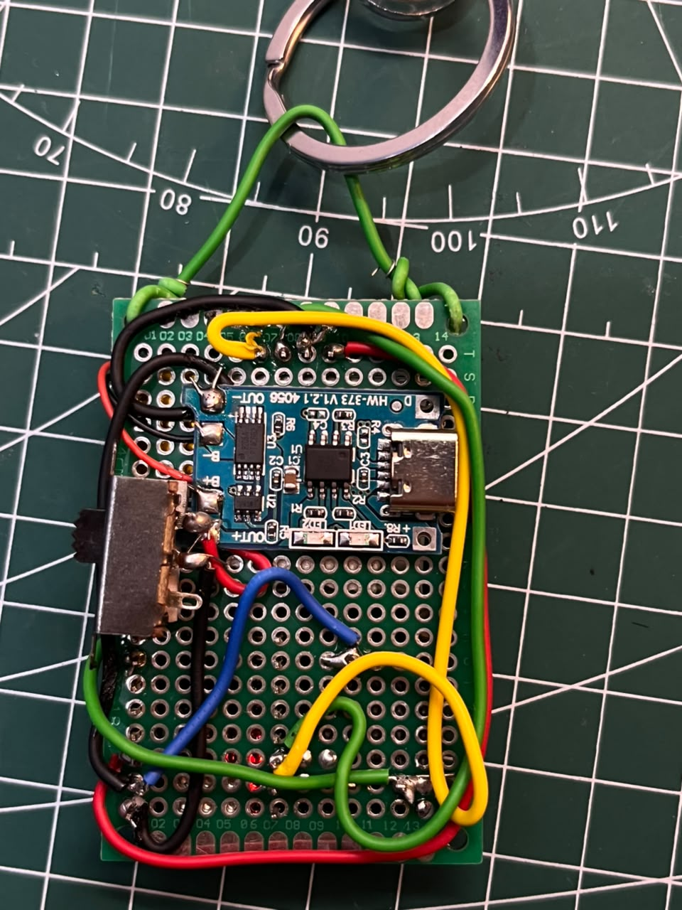

# Build the keychain

This guide describes the photographed ESP32-C3 prototype and its supplied working firmware. Start with USB power; the battery section describes the intended circuit and remaining checks for the exact components you use.

## 1. Gather the parts

| Part | Quantity | Notes |
| --- | --- | --- |
| ESP32-C3 SuperMini | 1 | Record the exact revision and regulator before finalizing battery instructions. |
| 1.3-inch I²C OLED | 1 | SH1106, 128 × 64, address 0x3C in the supplied sketch. The photographed module labels its header VCC, GND, SCK, SDA. |
| Momentary tactile button | 1 | Four legs; use a pair that connects only while pressed. |
| Slide switch | 1 | Physical battery-power switch. |
| TP4056 charge/protection module | 1 | The photographed module is marked HW-373E V1.21 and has B+/B− and OUT+/OUT− terminals. Verify the actual charge current. |
| Single-cell LiPo battery | 1 | The original target was 300 mAh, nominal 3.7 V. Confirm the installed cell's capacity and charge specification. |
| Double-sided perfboard | 1 | Individual holes are not automatically connected together. |
| Insulated hookup wire | As needed | Short connections between modules and a shared ground. |
| Keyring and attachment | 1 | The prototype uses a loop through the upper mounting holes. |
| USB data cable | 1 | For programming and initial testing. |

No MPU6050 is used in version one. No separate power-distribution board is required.

## 2. Prove the display over USB

Start with the C3 and OLED off the perfboard. Confirm that the display works before installing the battery circuit.

| OLED terminal | C3 connection |
| --- | --- |
| VCC | 3V3 |
| GND | GND |
| SDA | GPIO6 |
| SCK / SCL | GPIO7 |

The supplied current sketch configures **SDA = GPIO6** and **SCL = GPIO7**, using `U8G2_SH1106_128X64_NONAME_F_HW_I2C`. Do not infer pin assignments from wire colors or copy older 8/9 troubleshooting sketches.

The physical header on the photographed OLED reads **VCC, GND, SCK, SDA**, from pin 1 to pin 4. Follow your own module's labels; other modules can use a different order.

## 3. Add the button

With all power disconnected, find two button legs that read open when released and near zero ohms when pressed. The other two legs are duplicates and can remain unused electrically.

Connect the switching pair between the selected GPIO and C3 ground:

```text
C3 GPIO1 ---- momentary button ---- C3 GND
```

The supplied current sketch uses **GPIO1** with `INPUT_PULLUP`: released is HIGH and pressed is LOW. GPIO3 was a troubleshooting experiment, not the input used by this firmware.

Do not connect a button terminal to battery positive or 3V3 for this input arrangement.

## 4. Assemble on perfboard

The prototype places the screen above the electronics, with the button and C3 below it. The charge module, switch, and connecting wires are on the reverse.


- Solder the module headers securely. A pin pushed through a hole is not a reliable electrical connection.
- Use short insulated links to join individual pads; verify whether your board connects its top and bottom pads.
- Leave both USB connectors and the switch accessible.
- Insulate the battery from exposed pins and solder joints, and secure it so it cannot rub against them.



The photo records this prototype's assembly. Use the electrical connections below, rather than copying solder blobs or wire colors from the image.

## 5. Add battery power

The intended compact design uses the C3 board's onboard regulator rather than an external buck or buck-boost converter. Verify the input range and regulator of your exact C3 board first. Generic SuperMini documentation is not a guarantee for every clone.

```text
LiPo positive ---- TP4056 B+
LiPo negative ---- TP4056 B−

TP4056 OUT+ ---- slide switch ---- C3 5V / regulator input
TP4056 OUT− --------------------- C3 GND
             |------------------ OLED GND
             `------------------ Button ground

C3 3V3 ------------------------- OLED VCC
```

Two wires soldered to OUT−, or a branch partway along one wire, make the same shared ground. Keep system ground on the protected OUT− terminal, rather than bypassing protection by returning it to B−.

- A LiPo reaches approximately 4.2 V when fully charged. Never connect it directly to the C3's 3V3 pin.
- Set TP4056 charge current to the cell manufacturer's specification; do not assume a module's factory setting is suitable for 300 mAh.
- Keep the slide switch OFF when charging through the TP4056 or programming through the C3 USB connector.
- This simple arrangement does not provide play-while-charging power-path management.
- As the battery empties, the onboard regulator will eventually lose regulation. Low-battery behavior and usable runtime have not been measured yet.

References: [SuperMini board documentation](https://dl.artronshop.co.th/ESP32-C3%20SuperMini%20datasheet.pdf), [TP4056 datasheet](https://cdn.sparkfun.com/datasheets/Prototyping/TP4056.pdf).

## 6. Upload from Arduino IDE

1. Install the **esp32 by Espressif Systems** board package.
2. Install **U8g2** through Library Manager.
3. Select **ESP32C3 Dev Module**, enable **USB CDC On Boot**, and select the C3's own serial port.
4. Open `RoboPetEyes/RoboPetEyes.ino`.
5. Match `SDA_PIN`, `SCL_PIN`, `PET_BUTTON_PIN`, and the display constructor to your working hardware.
6. Upload. If required, hold BOOT, tap RESET, release BOOT, reselect the port, and retry.
7. Press RESET after upload and open Serial Monitor at 115200 baud.

The supplied firmware cycles through eight expressions, changing mood every 4.5 seconds during idle operation. One debounced press randomly selects a 5-second petting animation or a 6-second banana animation. Holding the button does not repeatedly trigger it. Presses during a reaction are ignored, and the robot returns to idle afterward.

Use the included `RoboPetEyes/RoboPetEyes.ino` filename so Arduino's sketch folder and `.ino` file share the same name. Avoid accidentally creating a double `.ino.ino` extension. The main firmware matches the builder's supplied working sketch, apart from trailing whitespace.

### Software versions

The builder's installed toolchain is Arduino CLI 1.5.1, ESP32 board package 3.3.12, and U8g2 2.36.19. The automated compile workflow pins these versions. The ESP32-C3 board identifier is `esp32:esp32:esp32c3`, with `CDCOnBoot=cdc` for USB serial output.

For a minimal bring-up before the full animation, upload `examples/DisplayCheck/DisplayCheck.ino`, followed by `examples/ButtonCheck/ButtonCheck.ino`. The button check prints transitions rather than repeating a line continuously.

## If it does not work

| Symptom | First check |
| --- | --- |
| No serial output | Successful upload, correct port, USB CDC enabled, then RESET. |
| OLED not detected | Actual GPIO labels, matching SDA/SCL code, solder joints, and signal continuity. |
| Detected but black | Correct controller constructor and supply measured directly at the OLED. |
| Button always released | Correct switching pair, actual GPIO, and a reliable connection to ground. |
| Different voltage at the pad and wire end | Probe contact and the connector/solder joint between those two points. |
| Board gets abnormally hot | Disconnect power and inspect before further testing. |

Resistance and continuity measurements must be made with USB and battery disconnected. A direct wire path should read close to the meter's probes-together resistance, not merely show some finite value.

## Verification status

- [x] Match the included firmware to the builder's supplied current sketch.
- [x] Record SDA = GPIO6 and SCL = GPIO7 from that sketch.
- [x] Record button = GPIO1 from that sketch.
- [x] Record SH1106, 128 × 64, address 0x3C from that sketch.
- [ ] Record installed battery, charge-current setting, and C3 regulator.
- [ ] Independently reproduce the physical assembly and documented upload sequence.
