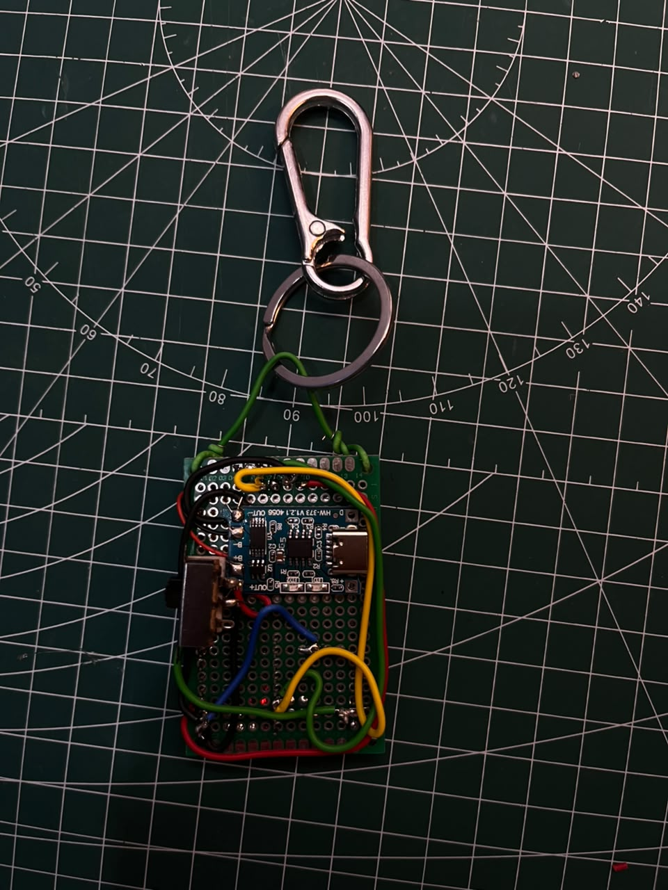

# Building the ESP32 Pocket Companion

The aim was a tiny character with exaggerated feelings: a robot you can carry, pet, and feed. The first version focuses on the face and a single interaction button.

## The idea

The original plan included an ESP32-C3, a 1.3-inch OLED, a small LiPo, charging, buttons, simple games, and an MPU6050. The sensor was left out of version one to keep assembly and interaction simple.

The eventual direction is a family of ordinary objects with personalities. A screaming wallet and a laptop-connected assistant are future ideas, not capabilities of this prototype.

## Getting a face on screen

Display bring-up took several attempts. The OLED worked on a regular ESP32 DevKit, which helped separate display operation from the C3 setup. During C3 troubleshooting there were missing I²C acknowledgments, ambiguous voltage readings, and pin changes.

The builder ultimately reported success with **GPIO6 and GPIO7**. The subsequently supplied current sketch records **SDA = GPIO6** and **SCL = GPIO7**, with the SH1106 128 × 64 constructor and address 0x3C. We did not establish a single confirmed cause for all earlier failures, and the photos do not prove that GPIO8/9 are inherently unsuitable.

## Making it expressive

The firmware work explored curious, happy, angry, sad, surprised, sleepy, smug, and affectionate faces. Blinking, gaze movement, and timing are intended to make a small set of shapes feel like a character.

The interaction is one button with two possible reactions: a hand pets the robot, or the robot eats a banana. The builder supplied the current sketch, which matches `RoboPetEyes/RoboPetEyes.ino` apart from trailing whitespace. Its petting reaction lasts five seconds and its banana reaction lasts six seconds.

## Putting it on perfboard

The assembled prototype has an OLED and button on the front, the ESP32-C3 below the screen, and a charge/protection module and switch on the back. A loop through the top mounting holes attaches it to a keyring.

The power arrangement uses a shared ground. Branching a ground wire and soldering multiple wires to the same OUT− point are electrically equivalent; neither requires a separate distribution board.

## Button lessons

Four-leg tactile switches contain two internally joined pairs. The chosen switching pair was measured open when released and near zero when pressed. Subsequent debugging compared the actual GPIO pad, header, and wire end rather than treating any resistance reading as proof of a sound connection.

GPIO1 became the button input after GPIO0 proved awkward to reach; GPIO3 was also tried during troubleshooting. The supplied current firmware confirms **GPIO1**, configured with the internal pull-up and pressed LOW.

## Prototype media — 23 October 2026

The builder supplied four photographs and three video files. The photos are embedded above and in the build guide. The video files are preserved without modification as three prototype demos.

- [Demo 1](media/demo-01.mp4)
- [Demo 2](media/demo-02.mp4)
- [Demo 3](media/demo-03.mp4)

## Still to document

Battery and charge settings, any earlier assembly photos, and measured runtime. Automated compilation is configured separately from physical reproduction; a passing software build does not verify battery behavior or assembly. This project is published as ESP32 Pocket Companion under the MIT license.
