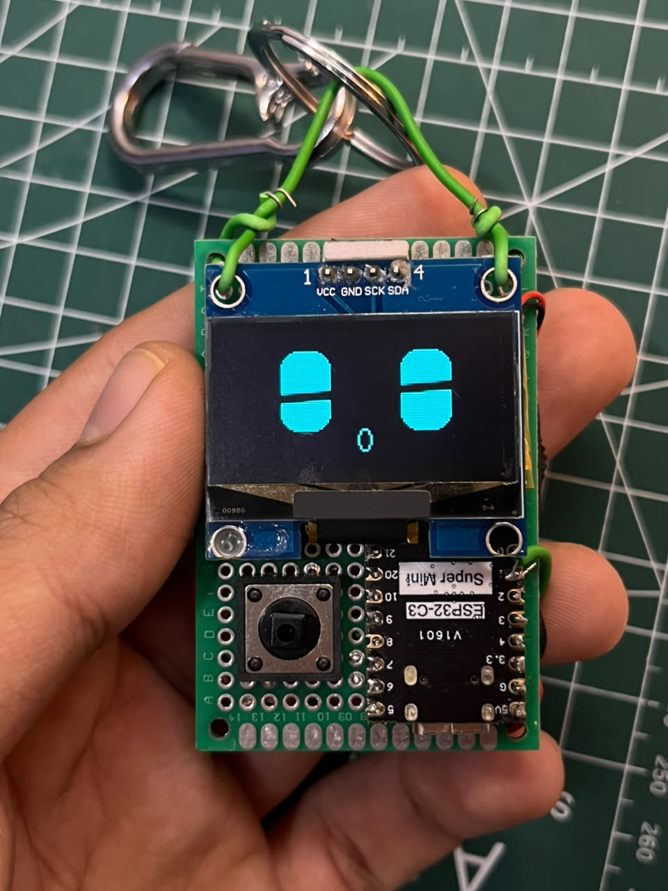
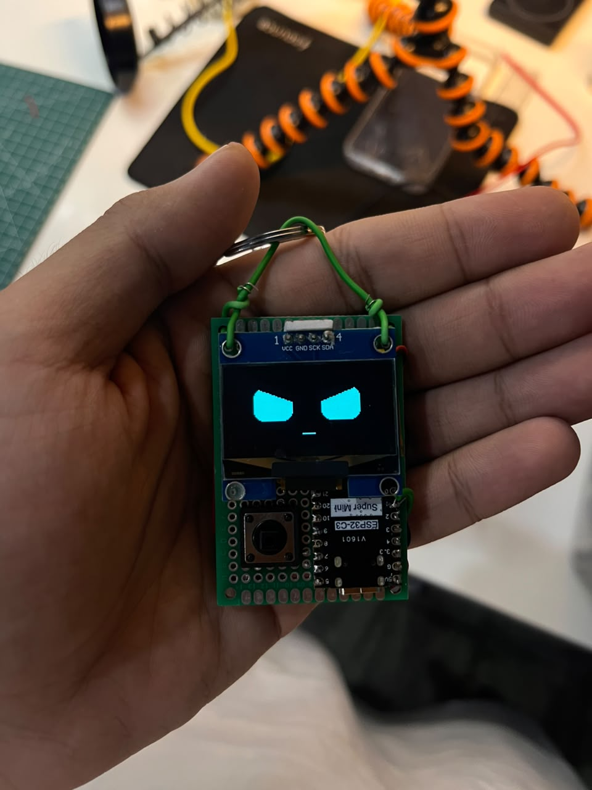

# ESP32 Pocket Companion

Hello reader. This project is merely a prototype to my first long-term project. It's the perfect way to begin learning basics such as
**I2C communication, soldering, perfboard prototyping, power management etc.**
It's a tiny robot that can be hooked on like a keychain, built on perfboard. Animated eyes, banana snacks, and a button for attention. No custom PCB required.

The idea is simple: make a small object feel like a character. Its expressions, pauses, and reactions matter as much as its electronics.

## What it does

- Eight expressions: curious, happy, angry, sad, surprised, sleepy, smug, and love.
- Blinking and wandering eyes, with a new mood every 4.5 seconds.
- One button randomly triggers petting or banana eating, followed by a return to idle.
- ESP32-C3, a 1.3-inch OLED, battery charging, and a physical power switch on double-sided perfboard.

This is a working personal prototype, shared so others can build and improve it. The supplied working sketch uses **OLED SDA = GPIO6, SCL = GPIO7, and button = GPIO1**. The display is configured as **SH1106, 128 × 64, I²C address 0x3C**. Battery performance and exact charger/regulator settings still need characterization; start with the USB-powered build.

## See it move

[Demo 1](media/demo-01.mp4) · [Demo 2](media/demo-02.mp4) · [Demo 3](media/demo-03.mp4)

Three unedited clips of the prototype, supplied by the builder.

## Build your own

You need an ESP32-C3 SuperMini, a 1.3-inch SH1106 I²C OLED, a tactile pushbutton, double-sided perfboard, wire, and a USB data cable. Battery operation adds a slide switch, a suitable single-cell LiPo, and a charge/protection module.

1. Wire OLED VCC → 3V3, GND → GND, SDA → GPIO6, SCL → GPIO7. Connect the button between GPIO1 and GND.
2. In Arduino IDE, install **esp32 by Espressif Systems** and **U8g2**. Select **ESP32C3 Dev Module**, enable **USB CDC On Boot**, and select your board's port.
3. Open [RoboPetEyes.ino](RoboPetEyes/RoboPetEyes.ino) and upload. Keep its folder and filename matched.
4. For the full assembly, charging notes, and troubleshooting, follow [BUILD.md](BUILD.md). For the journey and more photos, read [BUILDLOG.md](BUILDLOG.md).

Need to check one component first? Use the standalone [display check](examples/DisplayCheck/DisplayCheck.ino) or [button check](examples/ButtonCheck/ButtonCheck.ino).

## Controls

Press once for a randomly selected reaction: a five-second head pet or six-second banana snack. Holding the button does not repeat the action. New presses during a reaction are ignored.

## Development

See [CONTRIBUTING.md](CONTRIBUTING.md) for small ways to help and the compiler command. GitHub Actions is configured to compile the main sketch and both examples. Compilation does not verify physical wiring or battery safety.

## Next ideas

The original ambition was a companion that captures spoken ideas, sends them to a phone or laptop, and turns them into useful notes. That remains a future direction: the current build has no microphone or voice capture.

Other possibilities include simple games, a laptop-connected desk companion, and expressive notifications. These are plans, not current features. Version one leaves out the MPU6050 and does not connect to AI services.

## Reuse

[MIT licensed](LICENSE). See [ACKNOWLEDGMENTS.md](ACKNOWLEDGMENTS.md) for dependencies and inspiration. Contributions are welcome; keep the character expressive and the build approachable. I'd love for people to re-use my work in whatever way they want, just ensure that you use your own media. If you doubt there could be a problem, shoot me a DM on LinkedIn.
